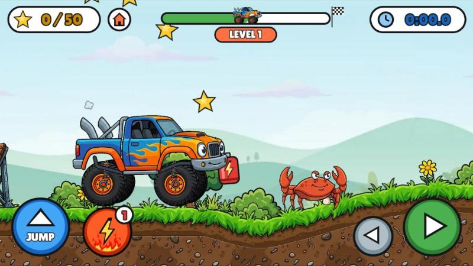
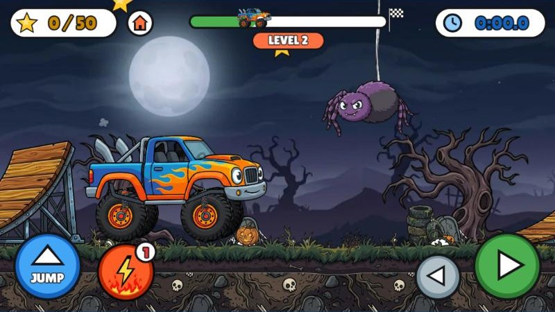
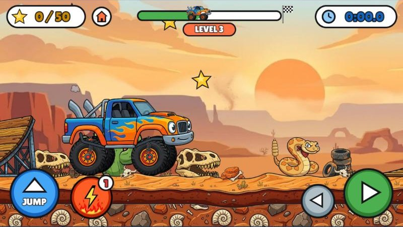
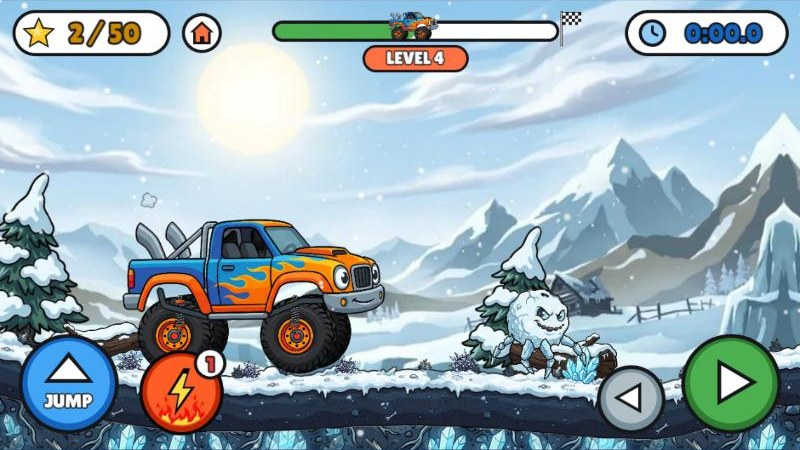

# BensBigAdventure

**Ben's Monster Truck Rally**: a side-scrolling monster truck game for a 6-year-old, built with [Phaser 3](https://phaser.io/).
Drive over bumpy hills, launch off ramps, smash cardboard boxes, grab nitro canisters for speed boosts, and collect gold
stars on the way to the finish gate. No game over: a crash or a fall into a pit just means trying the level again. A timer lets you chase your best time.

## Play it

**https://kdlippe.github.io/BensBigAdventure/**

Open that link in any browser: laptop, tablet or phone, from anywhere. There's nothing to install, and
it's always the latest version.

| Level 1: the meadow | Level 2: the spooky graveyard |
|---|---|
|  |  |
| **Level 3: the desert canyon** | **Level 4: the snowy mountains** |
|  |  |

## Playing on a tablet

- Open the link above in the tablet's browser.
- On Android / Amazon Fire tablets, tapping **GO!** switches to full screen and locks the screen sideways.
  Use the browser menu's "Add to Home screen" to get an app icon that opens straight into the game.
- On an iPad, use Safari's Share button → "Add to Home Screen" for an app icon. Safari can't lock the
  screen sideways, so use the rotation lock in Control Center. If the tablet is held upright, the game
  shows a "Turn me sideways!" screen.
- Progress (the level reached and best times) is saved in that browser, so each tablet or laptop keeps its own.

## Controls

| Action | Touch / mouse | Keyboard |
|---|---|---|
| Drive | big green ▶ button (hold) | → or D |
| Back up | small grey ◀ button (hold) | ← or A |
| Jump | blue JUMP button | Space, ↑ or W |
| Nitro boost (3 s, uses 1 charge) | orange ⚡ button | Shift or N |

## How it plays

- **4 levels**, one for each look, each with 50 stars and the same length. The level you're on shows
  under the progress bar. Finishing a level unlocks the next (**NEXT LEVEL**); the title screen offers
  **NEW GAME** or carries on from the level you reached, and the 🏠 button goes back to the title.
- **Music**: an original 16-bit (SNES-style) tune for each look - bouncy for the meadow, music-box
  spooky for the graveyard, a cowboy trot for the desert, a jingly sleigh ride for the snow - made
  in code (`src/music.js`). It always plays during a level; the title screen is quiet, and the music starts again with the next level.
- **Four looks**: level 1 is a sunny meadow; level 2 is a spooky graveyard at night (moon,
  tombstones, pumpkins, a pumpkin arch at the finish); level 3 is a desert canyon at sunset (cactuses,
  a T-rex skull, fossils in the dirt, a canyon arch at the finish); level 4 is snowy mountains with snow
  falling (snowy pines, a frozen log, ice crystals, snowball piles, an icy arch at the finish). Set per
  level with `theme` in `src/level.js`.
- **Ramps** on every level launch you into the air.
- **Pits** (as wide as the truck): level 1 has none. Level 2 has 2, each with a ramp right before it
  that flies you over. Levels 3 and 4 have 3: 1 with a ramp, and 2 with no ramp, so you jump those
  yourself (a little arc of stars shows where). Fall in and you start the level again.
- **Nitro**: you start with 1 charge and can carry up to 3 (the number on the ⚡ button). Each boost drives you
  forward at nearly double speed for 3 seconds. There are always 3 red nitro canisters on the track (one in each third), each giving a charge;
  some float high, so you have to jump for them.
- **Braking**: pressing back while boosting ends the boost and skids the truck smoothly to a stop
  (keep holding it to reverse).
- **Crabs** (up to 3 per level) scuttle back and forth. Jump and land on one to squish it (and bounce
  high); drive into one and KA-BOOM, the truck blows apart (see below).
- **Spiders** replace the crabs on the spooky level (2): they dangle on a thread, dropping down and
  climbing back up. Drive under one while it's high, jump over it when it's low, or land on it to squish it.
- **Rattlesnakes** replace the crabs on the desert level (3): they slither back and forth, rattling.
- **Snow spiders** replace the crabs on the snow level (4): grumpy snowballs on four icy legs that
  scuttle back and forth.
- Any enemy you touch while in the air and above its middle gets squished, so a jump in time always
  works.
- **Crashing**: touching an enemy without squishing it blows the truck up. There's a big explosion,
  the smashed truck flops down smoking, the wheels, shocks and bolts fly off and bounce away, and
  then you try the level again.
- **Stars, canisters and crabs** are in new places every time you start, so each run is a little different.
- **Timer** starts when you first drive and stops at the finish. Every star you miss adds 5 seconds
  to your total time (`MISSED_STAR_PENALTY` in `src/scenes/GameScene.js`). Each level's best time is remembered in that
  browser (each tablet or laptop keeps its own).

## Publishing

Every push to `main` publishes the game to GitHub Pages at the link above, within a couple of minutes
(`.github/workflows/pages.yml`). The workflow runs `tools/build_site.py`, which copies the game
into `_site/` and stamps every code file and picture with the commit's version; `index.html`
reads `version.txt` fresh on each visit and loads that version, so after an update browsers
never mix old and new files (which can freeze the game).

## Trying changes before publishing

To test a change on your own computer before pushing it, run this from the repo folder:

```bash
python tools/serve.py
```

Then open <http://localhost:8080>. (The game has to come from a web server; browsers won't load its
pictures from a plain file. This little server also tells browsers to always fetch fresh files, so
you never see a mix of old and new code.)

## Project layout

```
index.html              page that loads Phaser (from a CDN) and the game
src/main.js             game setup
src/scenes/BootScene.js loads the truck art, draws stars/boxes/buttons
src/scenes/TitleScene.js title screen: GO! / NEW GAME / keep going
src/scenes/GameScene.js the level: driving, jumping, boxes, stars, finish
src/level.js            the 4 levels: ramps, box stacks, pits, stars, canisters, crabs, scenery
src/progress.js         level reached and best time per level (saved in the browser)
src/scenery.js          backdrop, tiled dirt and the bendy grass strip, per theme (meadow / spooky / desert)
src/groundArt.js        grass strip sizes per theme (generated from the art)
src/rampProfile.js      the wooden ramp's curve (generated from the art)
src/flameArt.js         where the nitro flame leaves the pipe (generated from the art)
src/truck.js            the truck drawing (body, wheels, struts)
src/crab.js             the crab enemy: walking animation and squish
src/spider.js           the spider enemy (spooky levels): dangles on a thread, squish
src/snake.js            the rattlesnake enemy (desert level): slithers and rattles, squish
src/snowspider.js       the snow spider enemy (snow level): scuttles on icy legs, squish
src/sound.js            sound effects, generated in code (no audio files)
src/music.js            background music: 16-bit-style instruments, echo, and one song per look
assets/sprites/         the truck parts as transparent PNGs
assets/env/             ground, ramp, scenery and backdrop art
art/source/             the original art the game files were cut from
tools/slice_sprites.py  cuts the truck parts out of the truck art sheet
tools/slice_env.py      cuts/cleans the ground, ramp, scenery (all themes), flame, enemy, wreck and button art
tools/serve.py          local web server with browser caching turned off
tools/build_site.py     builds the published site with version-stamped files
docs/screenshots/       screenshots used in this README
```

## Tweaking

- **Levels**: the `LEVELS` table at the top of `src/level.js` sets each level's stars (exact count),
  length, number of ramps, box stacks, pits with a ramp (`rampPits`), pits to jump (`jumpPits`) and crabs. Each level's
  layout is random but the same every time you play it; stars, canisters and crabs move every play.
- **How the truck feels**: the constants at the top of `src/scenes/GameScene.js`
  (`MAX_SPEED`, `JUMP_SPEED`, `GRAVITY`, `RAMP_BOOST`, suspension `SPRING`/`DAMPING`, and the `NITRO_*` settings).
- **New art**: replace the PNGs in `assets/sprites/` with the same file names. If you get a new
  art sheet, re-run `python tools/slice_sprites.py`; for new ground/scenery art, replace the files in
  `art/source/` and re-run `python tools/slice_env.py` (both need `pip install pillow numpy scipy`).
